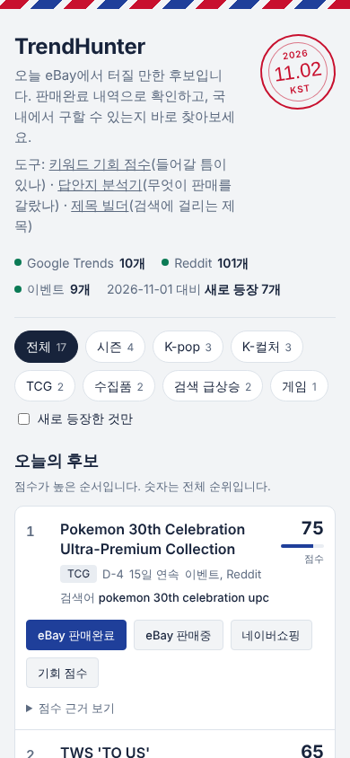
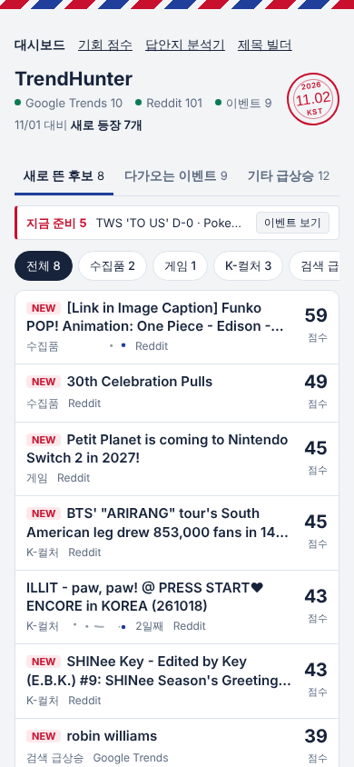
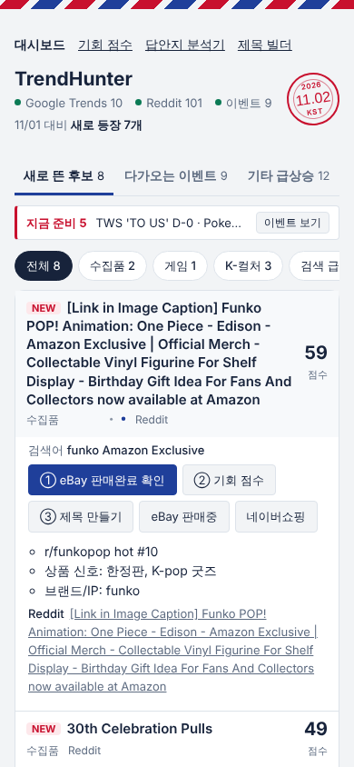

# TrendHunter v2

> eBay 해외 판매자를 위한 트렌드 발굴 + **eBay 검색 최적화(SEO)** 도구
> 바이브 코딩 2차 과제 리뷰 문서 · 1차 과제(v1) 리뷰는 [archive/README_v1.md](archive/README_v1.md)

| 페이지 | 하는 일 |
|---|---|
| [대시보드](https://ioveyou-creator.github.io/trendhunter/) | 매일 아침 자동으로 모은 판매 후보 (v1에서 개편) |
| [기회 점수](https://ioveyou-creator.github.io/trendhunter/opportunity.html) | 판매완료 수 대비 판매중 수로 들어갈 틈이 있는지 비교 |
| [답안지 분석기](https://ioveyou-creator.github.io/trendhunter/analyzer.html) | 팔린 리스팅과 안 팔린 리스팅을 비교해 판매를 가르는 요인 후보 찾기 |
| [제목 빌더](https://ioveyou-creator.github.io/trendhunter/title.html) | eBay 80자 제한 안에서 검색에 잘 걸리는 제목 만들기 |

모두 브라우저에서 바로 실행되고, 붙여넣은 데이터는 브라우저 밖으로 나가지 않습니다.
개발 기록: [DEVLOG.md](DEVLOG.md) · 요구사항: [PRD.md](PRD.md) · 작업 목록과 변경 기록: [TODO.md](TODO.md) · 스킬: [skills/ebay-seo-lens](skills/ebay-seo-lens/SKILL.md)

---

## 1. 제작한 것 소개

### v1에서 무엇이 문제였나

v1은 Google Trends, Reddit, 이벤트 캘린더를 매일 자동으로 모아 "오늘 eBay에서 터질 만한 후보"를 점수순으로 보여주는 대시보드였다. 3주 넘게 매일 자동 수집이 돌았고, 그 사이 세 가지 한계가 드러났다.

1. **점수가 실제 판매로 검증되지 않았다.** "한정판, 콜라보, 품절" 같은 단어에 가산점을 주는 그럴듯한 규칙이었을 뿐이다.
2. **초점이 없었다.** 3주 뒤 상위권이 같은 이벤트로 15일 넘게 채워졌다. 신호는 넓게 받지만 매일 새로운 판단을 주지 못했다.
3. **찾기에서 멈췄다.** 후보를 찾아도 eBay 검색에서 내 리스팅이 보이지 않으면 팔리지 않는다. v1은 그 단계를 다루지 않았다.

여기에 1차 발표 후 받은 **"SEO 관점으로 발전시켜 보라"**는 피드백이 더해졌다.

### 방향: 세 가지 기준으로 다시 설계

| 요소 | 뜻 | v1 | v2 |
|---|---|---|---|
| 상위 목표 | 이 일을 진짜 왜 하나 | 후보를 보여준다 | **적은 시간으로, 재고를 쌓지 않고, 지속 가능한 판매 수익을 만든다** |
| 답안지 | 현실에서 이미 채점된 데이터 | 없음 | eBay 완료 리스팅의 **팔린 것과 안 팔린 것** |
| 핵심 변수 | 결과를 가르는 딱 하나 | 없음 | 답안지에서 찾고, 그 하나에 도구를 맞춘다 |

이를 바탕으로 SEO에 대해 구체화를 진행했다.
- **eBay 검색 최적화 (중심):** 내 리스팅이 eBay 검색에서 발견되고 팔리게 만드는 것. 목표의 병목이라 v2의 중심으로 삼았다.
- **웹사이트 SEO (기본만):** 대시보드가 구글에 노출되는 것. 혼자 쓰는 도구라 효과가 작다. 실제로 개편 전에 Lighthouse로 재 보니 네 페이지 모두 이미 SEO 100점이었다. 그래서 Lighthouse가 보지 않는 항목(공유 미리보기, 대표 주소, 사이트맵, 구조화 정보)만 추가하고 테스트로 확인했다.

### 무엇이 달라졌나

| | v1 | v2 |
|---|---|---|
| 하는 일 | 후보 찾기 | 후보 찾기 → **틈 확인 → 판매 요인 분석 → 제목 만들기** |
| 페이지 | 대시보드 1개 | 대시보드 + 도구 3개, 공통 메뉴로 연결 |
| 판단 근거 | 단어 규칙 (검증 안 됨) | eBay 완료 리스팅(답안지)의 실제 판매 결과 |
| AI 작업 절차 | 없음 | 분석 스킬 `ebay-seo-lens` (SKILL.md + 계산 스크립트 + 평가 케이스 4개) |
| 대시보드 화면 | 카드 하나가 화면 반 | 탭 3개, 한 줄 행, 14일 점수 추이 그래프 |
| 웹사이트 SEO | 페이지 설명만 | 대표 주소, 공유 미리보기, 공유 이미지, 사이트맵, 구조화 정보 |
| 보안 | 대시보드 XSS 확인 | 네 페이지 모두 외부 전송 차단(CSP) + XSS 확인 |
| 자동 테스트 | 50개 | **파이썬 73개 + JavaScript 14개** |

### 한 흐름: 후보에서 제목까지

```
대시보드          후보 행을 누르면 다음 단계 버튼이 나온다 (검색어가 그대로 넘어감)
  │  ① eBay 판매완료 확인   실제로 팔리는 상품인가
  │  ② 기회 점수            팔린 수 ÷ 판매 중인 수 → 들어갈 틈이 있는가
  ▼  ③ 제목 만들기
답안지 분석기      완료 리스팅을 붙여넣으면 팔린 것 / 안 팔린 것의 키워드·가격·배송·판매 형식 비교
  ▼
제목 빌더          80자 안에서 중요한 순서로 조립, 실시간 점검,
                  답안지의 팔린 리스팅에 자주 나왔는데 내 제목에 없는 단어를 제안
```

- **기회 점수:** eBay 화면의 "결과 N개"를 사람이 옮겨 적는다. 자동 수집은 eBay 약관 문제로 하지 않았다. 대신 키워드를 넣으면 판매완료, 판매중, 완료 리스팅, 네이버쇼핑 검색 링크를 바로 만들어 준다. 재고 없이 팔려면 국내에서 구할 수 있어야 해서 "국내 소싱 확인" 표시를 함께 둔다.
- **답안지 분석기:** 영어 PC 화면과 **한국어 모바일 화면(원화, 할인가, 입찰, 베스트 오퍼, 출발지)**을 모두 읽는다. 처음 만든 파서는 가상 데이터로만 테스트해서 실제 화면을 한 줄도 못 읽었고, 실제 스크린샷 24개를 받아 다시 만들었다.
- **제목 빌더:** 12단계 분석에서 나온 가설 2개(판매 형식, 발송지)를 "리스팅 전 점검"으로 보여준다. 확정된 결론이 아니라서 "가설"이라고 표시했다.

### 대시보드 개편 (레퍼런스: Exploding Topics)

| | 개편 전 | 개편 후 |
|---|---|---|
| 모바일 첫 화면에 보이는 후보 | 1개 | **7개** |
| 데스크톱 첫 화면에 보이는 후보 | 2개 | **5개** |
| 상위 5개 중 새로 뜬 후보 (이벤트 제외) | 1개 | **5개** |
| Lighthouse 대시보드 (성능/접근성/권장/SEO) | 98/100/96/100 | 97/100/96/100 |

레퍼런스로 고른 Exploding Topics(트렌드 발굴 서비스)에서 가져온 것은 모양이 아니라 **"첫 화면에 무엇을 남기나"**였다. 이름과 핵심 숫자만 보이는 짧은 행, 필터 한 줄, 자세한 내용은 눌러서 보는 구조다. 몇 주째 그대로인 이벤트는 별도 탭으로 옮기고, 후보마다 매일 쌓아 온 기록으로 14일 점수 추이 그래프를 붙였다.

| 개편 전 (모바일) | 개편 후 (모바일) | 개편 후 (행 펼침) |
|---|---|---|
|  |  |  |

데스크톱: [개편 전](screenshots/v2/dashboard_before_desktop.png) · [개편 후](screenshots/v2/dashboard_after_desktop.png) · [다크 모드](screenshots/v2/dashboard_after_mobile_dark.png)

> 권장(Best Practices) 96점은 작업 환경에서 Google 글꼴 접속이 막혀 콘솔 오류가 나기 때문이다. 개편 전과 같다.

### 직접 실행하기

```bash
python -m pip install -r requirements.txt   # 처음 한 번 (Python 3.7 이상)
python -m unittest discover tests           # 파이썬 73개 (Node.js가 있으면 JS 14개도 함께)
python -m http.server -d docs               # → http://localhost:8000
```

분석 스킬만 따로 쓸 때:

```bash
python skills/ebay-seo-lens/scripts/analyze_listings.py 완료리스팅.txt --json 결과.json
```

---

## 2. PRD와 TODO

### PRD v2 요약 ([전문](PRD.md) · [v1 PRD](archive/PRD_v1.md))

- **상위 목표:** 적은 시간으로, 재고를 쌓지 않고, 지속 가능한 판매 수익을 만든다.
- **목표:** 팔린 리스팅과 안 팔린 리스팅을 비교해 판매를 가르는 요인을 찾는다 / 들어갈 틈을 보여준다 / 검색에 잘 걸리는 제목을 빠르게 만든다 / UI/UX 개편 / 웹사이트 기본 SEO / 모두 브라우저에서, 무료로
- **비목표:** eBay 페이지 자동 수집(약관), 자동 리스팅·가격 조정, **개인 판매 기록 공개**
- **신규 기능:** F10 답안지 분석기 · F11 핵심 변수 리포트 · F12 키워드 기회 점수 · F13 리스팅 제목 빌더 · F14 UI/UX 개편 · F15 웹사이트 기본 SEO · F16 분석 스킬
- **비기능:** 브라우저 실행, 붙여넣은 데이터 외부 전송 금지, 비용 0원, 한 소스가 실패해도 동작

### TODO v2 진행 ([전문](TODO.md) · [v1 TODO](archive/TODO_v1.md))

v1과 같은 방식으로 **단계마다 TODO를 체크하고 push했다.** 비교 기준점은 v1 제출 커밋에 붙인 `v1` 태그다.

| 단계 | 내용 | 커밋 |
|---|---|---|
| 9 | 목표 재설정, PRD·TODO v2, v1 문서 보관 | `12d8865` |
| 10 | 분석 스킬 `ebay-seo-lens` | `f974c56` |
| 11 | 답안지 분석기 (브라우저) | `ee1fb13` |
| 12 | 핵심 변수 찾기 (실제 데이터) | `fb59536` |
| 13 | 키워드 기회 점수 | `0190d33` |
| 14 | 리스팅 제목 빌더 | `7ab76f9` |
| 15 | UI/UX 개편 + 웹사이트 기본 SEO | `16956f8` |
| 16 | 리뷰 문서 (이 README) | 최종 커밋 |

그 사이 `data: 날짜 자동 수집` 커밋 24개는 GitHub Actions 로봇이 매일 남긴 것이다. v1의 자동 수집은 v2 작업 중에도 계속 돌았다.

---

## 3. TODO 변경 내역

### 처음 계획과 최종 결과

| 단계 | 처음 계획 | 최종 | 바뀐 이유 |
|---|---|---|---|
| 답안지 | 내 판매 기록 + 트래픽 리포트 | eBay 완료 리스팅의 팔린 것 / 안 팔린 것 | 개인 데이터는 공개 저장소에 못 올림. 시장 데이터는 누구나 재현 가능 |
| 10 스킬 | SKILL.md 하나 | SKILL.md + 계산 스크립트 + 제목 규칙 + 평가 케이스 | 같은 입력에 같은 숫자가 나와야 결론을 믿을 수 있음 |
| 11 분석기 | 붙여넣으면 팔림/안 팔림 구분 | + 한국어 모바일 화면·원화 대응, 스크린샷 경로, 파이썬/JS 결과 비교 테스트 | 실제 데이터가 모바일 한국어 화면이었고, 처음 파서는 한 줄도 못 읽음 |
| 12 핵심 변수 | 후보 상품 여러 개로 핵심 변수 확정 | 넓은 검색 1개(24개)로 **확정 보류, 가설 2개** | 데이터를 모바일로만 모을 수 있었고, 상품이 섞인 검색이라 원인을 구분할 수 없음 |
| 13 기회 점수 | 12단계 결과로 v1 점수 기준 조정 | **조정 보류**, 사람이 결과 수를 입력하는 방식 | 확정 안 된 가설로 점수를 바꾸면 v1의 "그럴듯한 규칙"을 반복함 |
| 14 제목 빌더 | 80자 조립 + 빠진 키워드 안내 | + 실시간 점검, 가설 2개를 "리스팅 전 점검"으로 | 스킬의 제목 규칙과 12단계 결과를 화면에서 바로 쓰게 함 |
| 15 개편 | 레퍼런스 보고 개편 + 페이지 설명·사이트맵 | + 개편 전후 측정, 점수 추이 그래프, SEO 점검 테스트. robots.txt는 삭제 | "구리다"를 숫자로 바꿔야 방향과 결과를 확인할 수 있음 |

### 전체 변경 기록 (TODO.md와 동일)

구분은 **추가 / 삭제 / 수정 / 테스트 후 변경** 네 가지다. 테스트 후 변경은 만들고 나서 직접 돌려 보거나 써 보고 바꾼 것이다.

| 날짜 | 단계 | 구분 | 무엇이 바뀌었나 | 왜 |
|---|---|---|---|---|
| 2026-11-01 | 계획 | 수정 | 메인 답안지를 "내 판매 기록 + 트래픽 리포트"에서 **eBay 완료 리스팅의 팔린 것/안 팔린 것**으로 변경 (계획 확정 전) | 개인 판매 데이터는 공개 저장소에 올리지 않기로 했고, 시장 데이터는 누구나 같은 방법으로 확인·재현할 수 있음 |
| 2026-11-01 | 계획 | 추가 | **15단계 UI/UX 개편** 추가 (계획 확정 전) | v1을 3주 동안 실제로 써 본 뒤 화면이 불편하다는 피드백 |
| 2026-11-01 | 10 | 추가 | 스킬에 **분석 스크립트, 참고 자료, 평가 케이스 3개** 추가 (처음 계획은 SKILL.md 하나) | skill-creator 가이드: 매번 같은 결과가 나와야 하는 계산은 스크립트로 묶고, 스킬은 테스트 케이스로 검증해야 함 |
| 2026-11-01 | 10 | 테스트 후 변경 | 분석 스크립트가 eBay 화면 맨 위 검색창·필터 글자를 "인식 못 한 줄"로 세지 않도록 수정 | 그대로 두면 정상 입력도 "형식이 다르다"는 잘못된 경고가 남 |
| 2026-11-01 | 10 | 테스트 후 변경 | 스크립트에서 Python 3.8 이상 전용 문법(`:=`)을 제거하고 3.7 문법 검사 추가 | 내 PC는 Python 3.7. v1 2단계에서 겪은 버전 문제를 반복하지 않기 위해 |
| 2026-11-02 | 11 | 테스트 후 변경 | 파서를 **한국어 화면·원화·할인가·입찰·베스트 오퍼·무료 국제 배송·출발지**까지 읽도록 다시 작성 | 실제 eBay 화면을 처음 받아 보니, 가상 데이터로 만든 파서는 **한 줄도 읽지 못함** (가상 데이터 테스트는 15개 모두 통과했었음) |
| 2026-11-02 | 11 | 추가 | **모바일 경로**: 스크린샷을 AI(스킬)가 CSV로 옮긴 뒤 분석기에 붙여넣기 | eBay 모바일 앱은 결과 화면 전체 복사가 안 돼서 스크린샷으로 받음 |
| 2026-11-02 | 11 | 테스트 후 변경 | 입찰 수, "베스트 오퍼 수락됨" 같은 **결과 지표는 원인 후보에서 제외**하는 규칙을 스킬에 추가 | 실제 데이터에서 "경매 형식"의 판매율이 입찰 여부와 완전히 겹침: 입찰 있는 경매는 전부 팔리고, 안 팔린 경매는 전부 입찰 0건 |
| 2026-11-02 | 11 | 추가 | 파이썬(스킬)과 JavaScript(브라우저) 결과를 비교하는 테스트 | 같은 규칙을 두 언어로 갖고 있어 한쪽만 고치면 어긋날 수 있음 |
| 2026-11-02 | 11 | 테스트 후 변경 | 반올림을 사사오입으로 통일, 키워드 순서를 고정 | 비교 테스트를 만들다 발견: 파이썬 `round()`는 0.0625→0.062, JS는 0.063. 또 파이썬은 실행마다 같은 점수의 키워드 순서가 바뀔 수 있었음 |
| 2026-11-02 | 11 | 테스트 후 변경 | 분석기 표에 최소 너비를 주고 표만 옆으로 밀어 보게 함 | 모바일(390px) 캡처에서 표 칸이 찌그러져 글자가 세로로 쪼개짐 |
| 2026-11-02 | 12 | 수정 | 답안지를 "후보 상품 여러 개"에서 **넓은 검색 1개(`pokemon`, 24개)**로 축소 | 데이터 수집 시점에 PC를 쓸 수 없어 모바일 스크린샷으로만 모을 수 있었음. 과제 일정상 이 범위로 진행하기로 결정 |
| 2026-11-02 | 12 | 테스트 후 변경 | 결과물을 "핵심 변수"에서 **"검증할 가설 2개"**로 변경 | 상품이 섞인 검색이라 스킬의 기준 2번(다른 요인으로 설명되지 않는가)을 통과하는 후보가 없었음 |
| 2026-11-02 | 13 | 수정 | "12단계 결과로 기존 점수 기준 조정" 보류 | 확정되지 않은 가설로 점수를 바꾸면 v1의 "그럴듯한 규칙" 문제를 반복하게 됨 |
| 2026-11-02 | 14 | 추가 | 제목 빌더에 가설 2개를 **리스팅 전 점검 항목**으로 표시 | 확정은 못 했지만 한국에서 발송하는 판매자에게 직접 해당되는 가설이라, 점수 대신 "확인할 것"으로 보여주는 편이 정직함 |
| 2026-11-02 | 13 | 수정 | 판매완료/판매중 수를 자동 수집하지 않고 **사람이 eBay 화면의 "결과 N개"를 입력**하는 방식으로 변경. 대신 두 검색 화면으로 가는 링크를 자동 생성 | eBay 판매완료 데이터는 무료로 자동 수집할 방법이 없음(약관, API 제한). 모바일만 쓸 수 있는 상황에서도 1분 안에 입력 가능 |
| 2026-11-02 | 13 | 수정 | 국내 소싱 가능성을 점수에 넣지 않고 **체크박스로 "확인 전/확인됨"만 표시** | 네이버쇼핑 결과를 자동으로 판단할 근거가 없음. 사람이 확인하는 항목으로 두는 편이 정직함 |
| 2026-11-02 | 13 | 추가 | 대시보드 후보 카드 → 기회 점수로 가는 버튼, 세 페이지 공통 메뉴 | 후보 발견 → 틈 확인 → 답안지 분석이 한 흐름으로 이어지도록 |
| 2026-11-02 | 13 | 추가 | 공통 스타일 파일 `tool.css` 분리 | 페이지마다 스타일을 복사하면 15단계 UI 개편 때 여러 번 고쳐야 함 |
| 2026-11-02 | 13 | 테스트 후 변경 | 모바일 비교표와 삭제 버튼 줄바꿈 수정 | 390px 캡처에서 "판단" 칸이 세로로 쪼개지고 "삭제"가 두 줄로 나뉨 |
| 2026-11-02 | 14 | 추가 | 제목 **실시간 점검** (길이, 대문자 남용, L@@K 같은 장식, 반복, 제목 속 무료 배송, 이모지) | 스킬의 제목 규칙(`ebay-title-rules.md`)을 사람이 매번 확인하지 않아도 되게. 실제 데이터에도 🔥, 전부 대문자인 제목이 있었음 |
| 2026-11-02 | 14 | 테스트 후 변경 | 키워드 제안 순서를 "판매율 차이순"에서 **"팔린 리스팅에 나온 개수순"**으로, 겹치는 두 단어 묶음 제거 | 써 보니 팔림 8개인 `photocard`보다 4개뿐인 `sealed photocard`가 먼저 나옴. 스킬 기준 1번(표본이 받쳐 주는가)과 어긋남 |
| 2026-11-02 | 14 | 테스트 후 변경 | 제안을 누르면 맨 끝(추가 키워드)이 아니라 **"핵심 특징" 칸**에, 팔린 제목에 쓰인 대소문자(`Photocard`, `POB`)로 들어가게 | 처음엔 `... Korean Ver photocard`처럼 맨 끝에 소문자로 붙음. 맨 끝은 80자를 넘으면 가장 먼저 잘리는 자리이고, 규칙은 "핵심 단어는 앞쪽에" |
| 2026-11-02 | 15 | 추가 | 대시보드를 **탭 3개**(새로 뜬 후보 / 다가오는 이벤트 / 기타 급상승)로 나눔 | 개편 전 측정: 모바일 첫 화면에 후보 1개, 상위 5개 중 4개가 2주째 그대로인 이벤트. 매일 새로 확인할 것이 아래로 밀림 |
| 2026-11-02 | 15 | 추가 | 후보마다 **14일 점수 추이 그래프** | "N일 연속"만으로는 오르는 중인지 식는 중인지 알 수 없음. 이미 쌓인 기록(`data/history`)을 재사용 |
| 2026-11-02 | 15 | 삭제 | `robots.txt` 계획에서 제외 | 이 사이트는 `github.io/trendhunter/` 아래라 검색엔진이 이 위치의 robots.txt를 읽지 않음. 넣어도 효과 없는 파일 |
| 2026-11-02 | 15 | 테스트 후 변경 | 데이터가 오기 전에는 목록을 그리지 않게 수정 | 개편 후 Lighthouse 성능이 98 → 75로 떨어짐. 원인은 레이아웃 밀림(CLS 0.70): 빈 틀이 먼저 그려졌다가 데이터가 들어오며 화면 전체가 밀림. 수정 후 97 |
| 2026-11-02 | 15 | 테스트 후 변경 | 후보 제목 단계를 h3 → h2 | Lighthouse 접근성 98: 제목 단계가 h1 다음 h3으로 건너뜀 |
| 2026-11-02 | 15 | 테스트 후 변경 | 하루만 나온 후보는 추이 그래프 생략, 띄엄띄엄 나온 날은 작은 점으로 | 캡처에서 점 하나짜리 그래프가 목록 기호(•)처럼 보였음 |
| 2026-11-02 | 15 | 테스트 후 변경 | 후보 행 클래스 이름 변경 (`row` → `cand-row`) | 공통 스타일의 `.row`(가로 배치)와 이름이 겹쳐 점수가 오른쪽 끝이 아니라 제목 바로 옆에 붙음 |
| 2026-11-02 | 16 | 추가 | v1 리뷰 README를 `archive/README_v1.md`로 보관하고 README를 v2로 새로 씀 | PRD·TODO처럼 v1과 나란히 비교할 수 있게 |

**구분별 개수:** 추가 11 · 삭제 1 · 수정 5 · 테스트 후 변경 14 (총 31건). 절반 가까이가 "테스트 후 변경"이다. 계획대로 만든 것보다 **돌려 보고 고친 것**이 더 많았다.

---

## 4. 스킬

### 만든 스킬: `ebay-seo-lens` ([SKILL.md 전문](skills/ebay-seo-lens/SKILL.md))

```
skills/ebay-seo-lens/
├── SKILL.md                         돋보기 3단계 절차 (108줄)
├── scripts/analyze_listings.py      답안지 계산 (표준 라이브러리만, Python 3.7 이상)
├── references/ebay-title-rules.md   eBay 제목 규칙과 점검표
└── evals/                           평가 케이스 4개 (가상 3 + 실제 1)
```

**왜 만들었나.** AI에게 "좋은 eBay 제목 써줘"라고 하면 일반론으로 그럴듯한 제목이 나온다. 이건 v1의 점수 규칙과 같은 문제다. 현실에서 채점된 적이 없다. 그래서 AI가 **매번 같은 순서로, 답안지에서 출발해, 딱 하나를 고르게** 하는 절차를 스킬로 고정했다. 대화할 때마다 설명하지 않아도 되고, 판단 기준이 대화마다 흔들리지 않는다.

**SKILL.md 내용**

1. **상위 목표:** 이미 정해져 있으면 그대로 쓰고, 없으면 묻지 않고 기본값을 쓴다. 성공 기준은 노출이 아니라 **판매(Sold)**다.
2. **답안지:** 같은 상품의 완료 리스팅(팔림 + 안 팔림)을 받는다. Sold 필터만 켜면 비교 대상이 사라지므로 Completed만 켜라고 안내한다. 계산은 직접 세지 않고 스크립트로 한다. 영어/한국어 화면을 모두 읽고, 모바일 스크린샷이 오면 CSV로 옮겨 적는다(잘린 값은 추측하지 않는다).
3. **핵심 변수:** 숫자가 가장 큰 것을 그대로 고르지 않는다. 아래 **네 가지를 모두 통과하는 하나**를 고른다.
   - 차이가 크고 표본이 받쳐 준다
   - 다른 요인으로 설명되지 않는다 (예: 무료 배송 리스팅이 전부 더 싸다면 진짜 변수는 총액)
   - 판매자가 바꿀 수 있다. **입찰 수, "베스트 오퍼 수락됨"처럼 팔린 결과로 생기는 값은 원인이 아니다**
   - 구체적이다 ("제목을 잘 쓴다"가 아니라 "제목 앞쪽에 with photocard")

   하나로 좁히기 어려우면 영상의 두 질문("목표를 10배로 키우면?", "시간을 1/10로 줄이면?")을 던진다. 통과하는 게 없으면 **억지로 고르지 않고 보류**한다.
4. **보고서 형식 고정:** 상위 목표 / 답안지 / 핵심 변수 / 다음 리스팅에서 할 일 / 버린 후보 / 이 분석의 한계
5. **개인 정보:** 다른 셀러 아이디를 적지 않고, 사용자의 판매 실적은 허락 없이 공개 파일에 쓰지 않는다.

**어떻게 쓰였나**

| 단계 | 쓰인 방식 |
|---|---|
| 10 | 정답을 숨겨 둔 가상 데이터 3개로 평가. 함정 케이스(무료 배송과 총액이 겹침, 표본 5개)에서 억지 결론을 내지 않는지 확인 → 15개 항목 통과 |
| 11 | 실제 데이터가 들어오면서 스킬 자체가 바뀜: 한국어 화면 규칙, 모바일 스크린샷 → CSV 절차, **결과 지표 제외 규칙** 추가. 실제 데이터 케이스를 더해 4개, 20개 항목 통과 |
| 12 | 실제 eBay 완료 리스팅 24개에 그대로 적용 → [분석 보고서](analysis/2026-11-02-pokemon-broad-search.md). 숫자만 보면 "경매가 덜 팔린다"가 컸지만, 입찰이 있는 경매는 전부 팔리고 안 팔린 경매는 전부 입찰 0건이었다. 스킬의 3번 기준이 이걸 원인 후보에서 걸러냈고, 결론은 **확정 보류 + 가설 2개** |
| 11·14 | 스킬의 계산 규칙을 브라우저(답안지 분석기, 제목 빌더)에 그대로 옮김. 두 언어의 결과가 같은지 매일 자동 테스트로 비교한다. 제목 빌더의 실시간 점검은 `ebay-title-rules.md`를 코드로 옮긴 것 |

스킬과 웹 도구는 같은 규칙의 두 얼굴이다. 사람은 브라우저 분석기로 숫자를 보고, AI는 스킬로 같은 숫자에서 판단과 보고서까지 간다.

### 고른 기존 스킬

| 스킬 | 언제 | 고른 이유 |
|---|---|---|
| `skill-creator` | 10단계, 스킬을 만들 때 | 스킬을 처음 만들어 봐서, 만드는 절차를 정리해 둔 스킬을 따랐다. "설명서를 써 두고 끝"이 아니라 **초안 → 평가 케이스 실행 → 채점 → 개선** 순서를 강제한다. 영상의 "답안지로 확인하기"와 같은 생각이라 골랐다 |
| `dataviz` | 15단계, 점수 추이 그래프 | 처음 그려 보는 차트라 감으로 그리지 않고 시각화 규칙을 따랐다. 선 하나는 흐린 색, 오늘 점만 강조, 범례 없음(선이 하나뿐), 값은 마우스를 올리면, 0~100 고정 축(행끼리 비교 가능) |

**주의한 점:** 스킬을 만든 AI가 평가 케이스를 직접 돌리고 채점까지 했다. 점수가 후하게 나올 수 있어서, 결과를 사람이 보는 리뷰 화면으로도 만들어 확인했다. 그리고 진짜 검증은 가상 데이터가 아니라 12단계의 실제 데이터였다. 가상 데이터 15개 항목을 모두 통과한 파서가 실제 화면은 한 줄도 못 읽었다.

---

## 5. 느낀점

**1. 답안지가 들어오자 모든 게 바뀌었다.**
v2에서 의미 있는 변경은 거의 다 실제 eBay 화면 스크린샷 7장이 들어온 뒤에 일어났다. 파서를 다시 썼고, 스킬에 규칙이 생겼고, 12~14단계 계획이 바뀌었다. v1에서 "실제 환경에서 돌려 봐야 안다"를 배웠다면, v2에서는 **"실제로 채점된 데이터가 있어야 판단할 수 있다"**를 배웠다. 

**2. "모르겠다"고 쓰는 것도 결과다.**
12단계에서 핵심 변수를 찾지 못했다. AI에게 "딱 하나를 찾아 줘"라고 하면 숫자가 가장 큰 것을 골라 그럴듯하게 설명할 수 있었다. 실제로 그 숫자(경매 38% vs 고정가 81%)는 충분히 그럴듯했다. 하지만 스킬에 넣어 둔 기준이 그걸 막았고, 그래서 13단계에서도 점수 기준을 바꾸지 않았다. 확정 안 된 결론으로 도구를 고쳤다면 v1의 "그럴듯한 규칙"을 한 번 더 만들었을 것이다.

**3. 테스트 통과와 쓸모는 다르다. 이번에도.**
v1의 화살표 노이즈처럼, v2에서도 테스트는 다 통과했는데 직접 써 보니 틀린 것이 있었다. 제목 빌더는 표본이 작은 단어를 먼저 제안했고, 제안한 단어를 80자를 넘으면 가장 먼저 잘리는 맨 끝에 붙였다. 개편한 대시보드는 보기에는 좋아졌는데 성능 점수가 98에서 75로 떨어졌다. 셋 다 눈으로 보거나 재 보지 않았으면 그대로 올라갔을 것이다.

**4. AI의 보고는 여전히 확인해야 한다.**
v1에서 겪은 "성공했다는데 파일이 그대로" 문제 때문에 v2 내내 파일을 옮길 때마다 양쪽 체크섬을 대조했다. AI가 쓴 테스트의 기대값이 틀린 경우도 v2에서 세 번 더 있었다(모두 코드가 아니라 테스트가 틀림).

## 6. 결론

**만든 것:** v1의 "후보를 찾는 대시보드"를 **후보를 찾고 → 들어갈 틈을 확인하고 → 팔린 리스팅을 근거로 무엇이 판매를 가르는지 보고 → 검색에 잘 걸리는 제목을 만드는** 한 흐름으로 넓혔다. 그 판단 절차는 `ebay-seo-lens` 스킬로 고정해, 브라우저 도구와 AI가 같은 규칙으로 움직인다. 모두 브라우저에서 무료로 돌아간다.

**SEO에 대해:** 교수님이 제안한 SEO를 "eBay 검색 최적화"로 해석한 것이 이번 과제의 가장 큰 결정이었다. 웹사이트 SEO는 개편 전부터 Lighthouse 100점이라 점수로 보여줄 개선이 없었고, 판매로 이어지는 병목은 eBay 검색 쪽에 있었다.

**아직 부족한 것:** 핵심 변수를 확정하지 못했다. 답안지가 상품이 섞인 넓은 검색 하나(24개)뿐이었기 때문이다. 다음은 한 상품을 가리키는 검색어로 팔림·안 팔림 각 10개 이상을 모아 두 가설(판매 형식, 발송지)을 확인하는 것이다. 확인되면 그때 v1의 점수 기준을 고친다.

**바이브 코딩에 대해:** v1의 결론은 "사람의 역할이 코드 작성에서 검증과 판단으로 옮겨 갔다"였다. v2에서 하나를 더 배웠다. **AI에게 무엇을 근거로 판단할지(답안지)와, 근거가 부족할 때 멈추는 기준을 먼저 주어야** AI의 속도가 그럴듯한 오답을 빨리 만드는 데 쓰이지 않는다. 스킬은 그 기준을 대화가 바뀌어도 잊지 않게 적어 두는 방법이었다.
